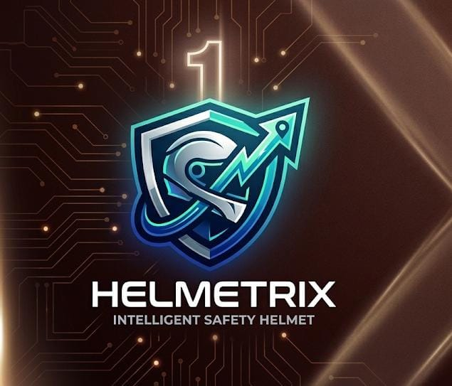

<p align="center"></p>

# HELMETRIX — Crash-Sense Helmet System

> **Status: 🚧 In progress — Phase 2 of 4 (team's own roadmap), prototype under development.**
> This is an **unfinished student prototype**. The repository currently contains the project design, documentation and one bench photo of components being assembled. **No firmware and no test results have been added yet.** Nothing here should be read as a working, tested, or certified safety device.

*Last status update:* `[DATE — update every time you add something]`

---

## 1. Problem

Two-wheeler riders can be seriously injured in crashes, and an injured rider may be unable to call for help. HELMETRIX explores a low-cost idea: a helmet-mounted electronics module that **detects a possible crash from motion data and sends an SMS with the rider's GPS location**, without depending on a Bluetooth connection to a phone.

> Road-safety statistics are deliberately not quoted here until they can be cited from an official source. `[Add 1–2 verified statistics: source, year, link.]`

## 2. Project goal

A bench-tested prototype that:

1. Reads motion data from an accelerometer/gyroscope (MPU6050).
2. Applies **fixed, hand-tuned rules/thresholds** (not machine learning) to flag a possible crash.
3. Reads a GPS position (NEO-6M).
4. Sends an emergency SMS with a map link through a GSM module (SIM800L).
5. Gives local feedback (buzzer/LED).

Phase 2 explores additional modules (heart-rate/SpO₂ sensing, SD-card logging, head cooling). These are **experimental and unverified** — see §3.

## 3. Design evolution

The project has been described in two stages. **Which one reflects the hardware actually being built is `[to confirm]`.**

| Item | Phase 1 design (project presentation) | Phase 2 design (as described by the team, April 2026) |
|---|---|---|
| Microcontroller | Arduino Nano | ESP32 |
| Motion sensing | MPU6050 | MPU6050 |
| GPS | Neo-6M | NEO-6M |
| GSM / SMS | SIM800L | SIM800L |
| Alcohol-vapour sensor | MQ-3 | Not mentioned `[kept / dropped?]` |
| Buzzer, LED, SOS button | Listed | Not mentioned `[kept / dropped?]` |
| Heart rate / SpO₂ | — | MAX30102 |
| Data logging | Future scope | Micro SD module |
| Head cooling | — | Peltier cooling system |
| Power | Battery + power module | `[to document]` |

The bench photo ([`media/photos/`](media/photos/)) shows loose components and jumper wires laid out for assembly — including what appears to be a breadboard, battery holder, power module, buzzer, micro-SD module, a motion-sensor board and a small temperature-sensor board. `[Confirm the parts and date.]` It is evidence that assembly was under way, **not** evidence that any feature works.

## 4. Current status at a glance

| Area | Status |
|---|---|
| System design / block diagram | ✅ Documented in [`docs/ARCHITECTURE.md`](docs/ARCHITECTURE.md) |
| Components selected | ✅ Phase 1 and Phase 2 lists above |
| Components obtained / assembly started | ⚠️ Bench photo shows parts laid out; `[confirm what is wired]` |
| Firmware written | ❓ `[Not in this repo — add or state "not yet"]` |
| Any feature tested | ❌ No test evidence yet |

Full evidence table: [`docs/PROJECT_STATUS.md`](docs/PROJECT_STATUS.md).

## 5. Planned system overview

```
 [MPU6050] --I2C--> [ESP32 / Arduino Nano] --> rules/thresholds --> (possible crash?)
                          |                                              |
 [NEO-6M GPS] --UART-->   |                                              v
 [MAX30102] --I2C (Ph.2)->|                                 read GPS fix -> build SMS
 [microSD] --SPI (Ph.2)-- |                                              |
 [MQ-3, SOS button (Ph.1)]|--> [Buzzer] [LED]                            v
                          `-------------------------------------> [SIM800L] --SMS--> chosen contact(s)
```

This is **design intent, not a verified wiring diagram**. Technical review: [`docs/ARCHITECTURE.md`](docs/ARCHITECTURE.md).

## 6. Features

### Confirmed implemented
*None confirmed yet.* `[Move items here only when code exists in this repo and you have run it.]`

### Confirmed tested
*None yet.* `[Link each item to a row in tests/ with date, setup and result.]`

### Planned / in design (not built or verified)
- Rule/threshold-based detection of abnormal motion from MPU6050 data
- GPS location in an emergency SMS (NEO-6M + SIM800L)
- Local buzzer/LED indication
- Phase 2 experiments: MAX30102 heart-rate/SpO₂ reading, micro-SD data logging, Peltier head cooling
- Phase 1 items whose status is unclear: MQ-3 alcohol-vapour reading (see limitations — **not** an impairment test) and SOS button

## 7. Hardware

Parts are listed in §3. **No part revisions, quantities, prices or suppliers are recorded yet** — see [`hardware/`](hardware/).

`[Add: exact boards (e.g. ESP32 dev board model), battery type/capacity, charger/regulator, SIM/operator used.]`

## 8. Software

`[Not yet added.]` When code exists, document: IDE/toolchain version, board package, libraries with versions, and upload steps. See [`firmware/README.md`](firmware/README.md).

## 9. Setup & wiring

`[Not yet available.]` The wiring image in the presentation is an **illustration, not a verified build**. Add a real pin table and a photo or diagram of what you actually wired — template in [`hardware/README.md`](hardware/README.md).

## 10. Operation

`[To be written after the prototype runs.]` Intended flow: power on → sensors initialise → continuous monitoring → rule triggered → (planned: countdown/cancel) → GPS read → SMS → buzzer/LED.

## 11. Testing

No results yet. A safe test plan, with what each test demonstrates and what to record, is in [`docs/TESTING_PLAN.md`](docs/TESTING_PLAN.md). Log template: [`tests/test_log_template.csv`](tests/test_log_template.csv).

## 12. Limitations

- Not yet built/tested — no performance claims are made.
- **Rule/threshold-based, not AI/ML, and not "predictive"** — it can only react to motion after it happens.
- A helmet-mounted sensor can mistake a dropped helmet for a crash, and may miss a low-impact fall.
- GPS needs sky view and a satellite fix, which can be slow or fail.
- SIM800L is **2G (GSM) only**; availability depends on operator, region and area.
- MAX30102 is a hobby-grade optical sensor, **not a medical device**; readings are unreliable with motion or poor skin contact.
- Peltier cooling draws high current and adds heat-management and electrical-safety issues; its benefit for the rider is unproven.
- MQ-3 (if kept) detects alcohol vapour approximately; it **cannot** determine blood-alcohol level or fitness to ride.
- Not certified or tested to any helmet or electronics standard. See [`docs/SAFETY_PRIVACY_LIMITATIONS.md`](docs/SAFETY_PRIVACY_LIMITATIONS.md).

## 13. Safety & privacy notes

- **Never test crash detection by crashing, dropping or striking a helmet while anyone is wearing it.** Use the bench methods in the test plan.
- Do not cut, drill, glue or otherwise modify a certified helmet shell or liner to fit electronics.
- Location and heart-rate data are personal data. Send alerts only to contacts who agreed to receive them; log data only with informed consent. Never commit real phone numbers, SIM details, location or health logs.

## 14. Future work (plans, not existing features)

See [`docs/FUTURE_WORK.md`](docs/FUTURE_WORK.md). Summary:

1. Assemble and test the basic sensor → alert flow
2. Tune thresholds; measure false alarms and missed triggers in safe, controlled tests
3. Add an alert countdown + cancel button
4. Test GPS, SMS, battery and failure cases
5. Check 2G availability in the test area; consider a newer module if needed
6. Evaluate Phase 2 modules (MAX30102, micro-SD logging, Peltier) one at a time, with power and thermal-safety checks
7. Validate the MQ-3 carefully if it is kept (no impairment claims)
8. Optional ML experiment — only after enough safe, consented data, compared against the rule-based baseline
9. Secure the electronics without modifying a certified helmet

## 15. Team

Team as listed on the presentation title slide (SIP project). **Roles are not yet recorded — fill in one honest line each.**

| Name | Contribution |
|---|---|
| Hansika Gajjala | `[...]` |
| Rushmitha Reddy | `[...]` |
| Diptesh Mohanty | `[...]` |
| Madhan G. | `[...]` |

Mentor: Dr. S. Bhanu Prakash.

## 16. Presentation & media

- **Presentation:** The project was presented on **16 April 2026** at the *"Arrive Alive" Road Safety Awareness Programme* held at Woxsen University, Sangareddy (Telangana). The programme was organised by Woxsen University with Telangana government/police officials attending, along with over 500 students and academic leaders (per the university's event write-up). Officials named in the university's write-up: Shri Mahesh Muralidhar Bhagwat, IPS (Additional DGP, Law & Order, Telangana); Pankaj Paritosh (Superintendent of Police, Sangareddy); Ms. P. Pravinya, IAS (Collector & District Magistrate, Sangareddy). `[Confirm wording of the collaboration with Telangana Police/Government.]`
- **Press:** *The Hindu* — "Woxen University students showcase smart safety helmet at road safety drive", The Hindu Bureau, Sangareddy, published 16 April 2026. Link: <https://lnkd.in/gk8eguRM> `[replace with the direct thehindu.com URL if available]`
- **Event write-up:** [Woxsen University news page](https://woxsen.edu.in/news/woxsen-hosts-arrive-alive-road-safety-programme/)

Presenting at an event or being covered in the press is not a test or approval of the prototype.


## 17. Acknowledgements

Mentor: Dr. S. Bhanu Prakash · Woxsen University · `[libraries, tutorials and code sources once code exists]`

## 18. License

`[Choose before accepting contributions — e.g. MIT for code; decide separately for docs/images.]`

## 19. Image credits

- `media/photos/` — team's own bench photo `[date, photographer]`.
- `docs/images/` — graphics from the project presentation. They appear to be **conceptual illustrations, not photos of the build**; `[confirm how they were made and credit the tool/source]`.
- Press and event photos are **not** included (copyright/consent); use the links above.
